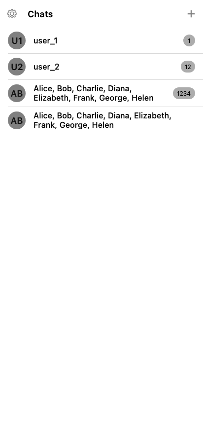
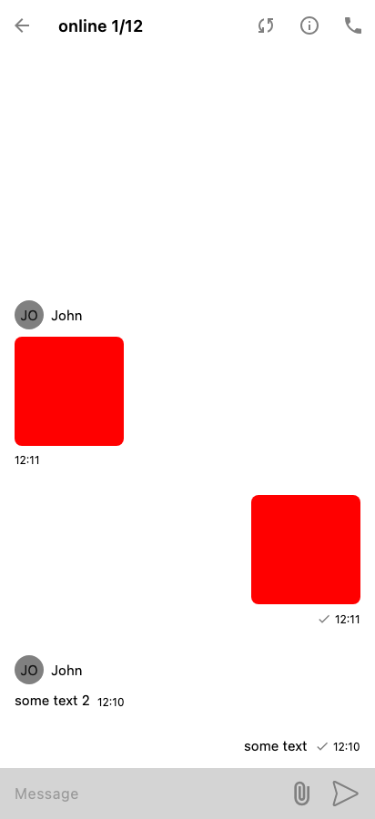
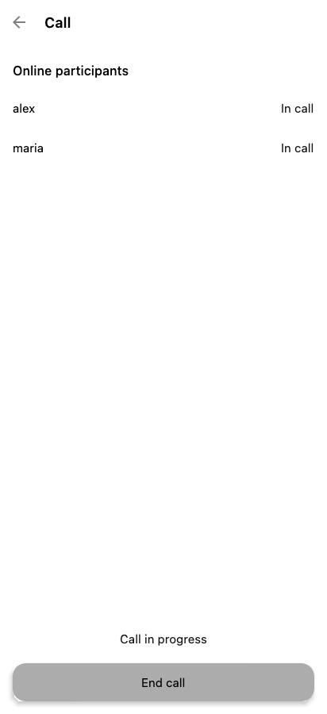
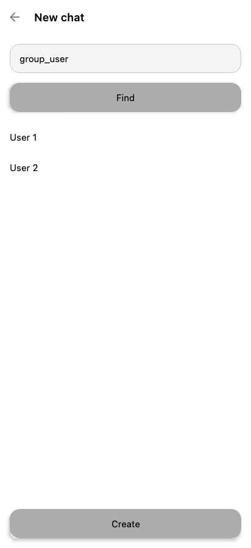
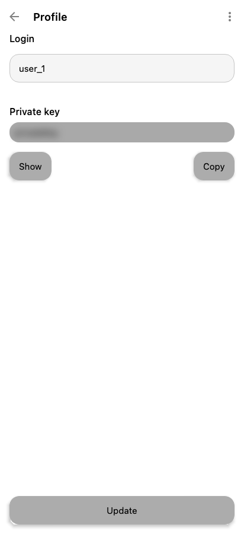

# Paranoya

This is the source code for **Paranoya**, a private messenger built with **Kotlin
Multiplatform** and **Compose Multiplatform**. It shares application logic and UI across Android,
iOS, and a JVM desktop app.

**[Download Paranoya on Google Play](https://play.google.com/store/apps/details?id=com.security.chat.multiplatform.android)**

## Features

- **Key-based accounts.** Register with a username and generate a key pair on your device. Sign in
  using your private key, without a phone number or email address.
- **Personal and group chats.** Find people by username, create conversations, view chat members,
  and add participants to existing groups.
- **Encrypted text and images.** Send text messages and photos, with full-screen image viewing.
- **Message status.** Track sending, sent, delivered, and read states, with unread counters in the
  chat list.
- **Live updates.** Receive messages and chat events over WebSocket and see online participant
  counts.
- **Message deletion.** Delete your messages for everyone in a conversation.
- **Audio calls on Android.** Start or join a chat's audio room and see who is in the call. Audio
  uses WebRTC, with direct connections or TURN relay.
- **Profile management.** Change your username, view or copy your private key, and delete your
  profile.
- **Personalization.** Choose light, dark, or system theme. English and Russian are supported.
- **Android notifications.** Get new-message notifications and manage notification permissions
  from settings.

Audio calls are currently implemented on Android. iOS and JVM audio implementations are pending;
push notification delivery is also currently implemented on Android.

## Screenshots

These images are copied from the UI modules' screenshot test references into
[docs/screenshots](docs/screenshots). They show Compose previews with test data, including
placeholder images in the conversation.

<table>
  <tr>
    <th>Chats and unread messages</th>
    <th>Conversation</th>
    <th>Audio call</th>
  </tr>
  <tr>
    <td></td>
    <td></td>
    <td></td>
  </tr>
  <tr>
    <th>Create a group</th>
    <th>Profile</th>
    <th>Dark theme</th>
  </tr>
  <tr>
    <td></td>
    <td></td>
    <td></td>
  </tr>
</table>

## Encryption and local storage

Messages and image attachments are encrypted on the device with **AES-256-GCM**. Each message's
encryption key is protected separately for each recipient using **RSA-OAEP with SHA-512**. Incoming
content is decrypted on the recipient's device using their private key.

The private key also serves as the sign-in credential and can be viewed or copied from the profile
screen. Account keys and tokens use encrypted settings, and local message storage uses SQLDelight
with SQLCipher-backed database drivers.

## Technology and architecture

| Area                     | Technology                                               |
|--------------------------|----------------------------------------------------------|
| Shared code and UI       | Kotlin Multiplatform, Compose Multiplatform, Material 3  |
| Navigation and lifecycle | Decompose, Essenty                                       |
| Dependency injection     | Koin                                                     |
| Async work and state     | Kotlin Coroutines, Flow, remo                            |
| Networking               | Ktor, WebSocket, kotlinx.serialization                   |
| Persistence              | SQLDelight, SQLCipher, encrypted settings                |
| Cryptography             | cryptography-kotlin                                      |
| Android audio            | WebRTC                                                   |
| Android notifications    | Firebase Cloud Messaging, WorkManager                    |
| Testing                  | JUnit, Mokkery, Compose UI tests, screenshot comparisons |
| Build                    | Gradle Kotlin DSL, convention plugins, version catalog   |

```text
androidApp/    Android entry point
iosApp/       SwiftUI host and Xcode project
shared/       App assembly, navigation wiring, and desktop entry point
common/       Shared infrastructure, UI kit, resources, and utilities
features/     Feature modules split by responsibility
build-logic/  Gradle conventions and module dependency validation
```

Features use separate `domain`, `data`, `data-network`, `data-storage`, `data-common`, `ui`,
`component-api`, and `component` modules as needed. Gradle validates direct project dependencies to
enforce layer boundaries. See [AGENTS.md](AGENTS.md) for repository conventions and
[the module list](settings.gradle.kts) for the complete project structure.

## Getting started

### Prerequisites

- JDK **25** for the application toolchain; build logic targets JVM **21**.
- Android Studio and the Android SDK for Android builds. The current configuration uses compile
  SDK **37** and min SDK **26**.
- macOS and Xcode for iOS builds. The deployment target is **iOS 15.0**.

Use the included Gradle wrapper. Dependency and SDK versions are defined in
[gradle/libs.versions.toml](gradle/libs.versions.toml).

### Android App Bundle in GitHub Actions

#### Production build

In the GitHub repository, open **Settings → Secrets and variables → Actions → Secrets → New
repository secret**. Create `GOOGLE_SERVICES_JSON` and paste the full contents of
`androidApp/google-services.json` for the production Firebase app.

With only `GOOGLE_SERVICES_JSON`, the workflow creates an unsigned AAB. To produce a bundle for
Google Play, add all four signing secrets using the keystore that holds the app's Play upload key.

| Repository secret         | Value                                             |
|---------------------------|---------------------------------------------------|
| `RELEASE_KEYSTORE_BASE64` | Base64-encoded contents of `release.keystore`     |
| `RELEASE_STORE_PASSWORD`  | Value of `storePassword` in `keystore.properties` |
| `RELEASE_KEY_ALIAS`       | Value of `keyAlias` in `keystore.properties`      |
| `RELEASE_KEY_PASSWORD`    | Value of `keyPassword` in `keystore.properties`   |

On macOS, run this from the repository root to copy the encoded keystore to the clipboard, then
paste it into `RELEASE_KEYSTORE_BASE64`.

```bash
base64 < release.keystore | tr -d '\n' | pbcopy
```

Once the workflow is on the default branch, open **Actions → Android App Bundle → Run workflow**.
Select `prod` for `serverEnv` and leave `enableLogs` and `isDebug` unchecked. Download the `.aab`
from **Artifacts** on the completed run.

#### Development build

To build with `serverEnv=dev`, add the `DEV_BASE_HOST` repository secret with the `devBaseHost`
value from `local.properties` and set the `enableLogs` and `isDebug` flags for the run.

#### Build Scan

To publish a report after each Gradle build, review
the [Gradle Terms of Use](https://gradle.com/terms-of-service)
and set the repository variable `GRADLE_BUILD_SCAN_TERMS_ACCEPTED` to `yes` under **Settings →
Secrets and variables → Actions → Variables**.

Open the Build Scan link in the run's **Summary** to see task timings, cache usage, and dependency
resolution. The report is hosted on `scans.gradle.com` and is accessible to anyone with the link.
Build console logs stay in GitHub Actions.

## Tests

```bash
./gradlew jvmTest
./gradlew checkScreenshots
./gradlew uiTest
./gradlew -p build-logic test
```

These commands run unit tests, screenshot comparisons, app UI scenarios, and build-logic tests,
respectively. Screenshot and UI scenarios use separate tags and are excluded from ordinary
`jvmTest` runs.

Reference images live in each UI module's `src/jvmTest/resources/screenshots` directory. To
regenerate
a module's references after an intentional UI change, run its `recordScreenshots` task, for example:

```bash
./gradlew :features:chat:chat-ui:recordScreenshots
```

See [app UI tests](shared/src/jvmTest/README.md) for scenario execution and optional video
recording,
and [audio call documentation](features/call/README.md) for call behavior and protocol details.
