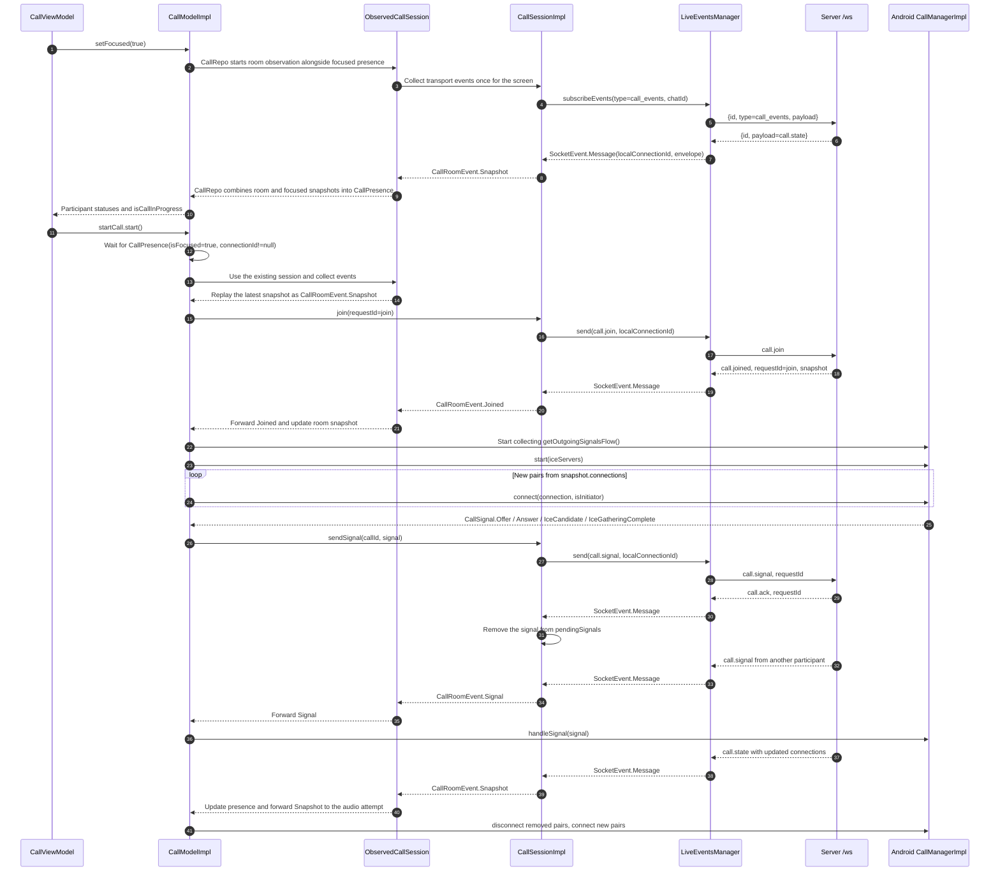
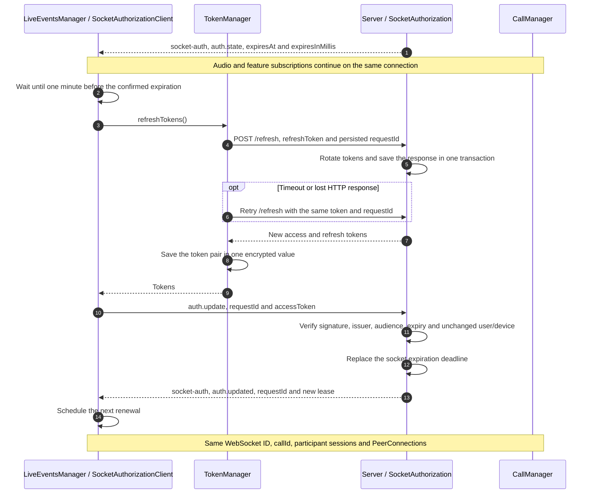

# Calls

This document describes the current implementation of audio calls in a shared chat room. Users
viewing the call screen publish `focused` presence; each user joins audio by pressing the call
button. Opening the screen alone does not enable the microphone. There is no incoming-call
accept/reject flow in this version.

While the screen is active, the client watches both focused presence and the audio room. A
participant's status is empty when they are only viewing the screen, and shows “In call” when at
least one of their devices has joined audio. While local audio is idle, the button shows “Call” for
an empty audio room or “Join” if anyone has already joined. During the local call it shows “End
call”. English and Russian labels are provided by localized resources.

All application subscriptions and call commands use one authenticated WebSocket at `/ws`. WebRTC
carries audio between participants directly or through TURN. The application server manages the room
and relays SDP/ICE; it does not carry audio.

The diagrams use Mermaid. Arrow labels show message types and decoded fields; the actual `payload`
is a JSON-encoded string.

## Overall sequence

In this diagram, A creates the call first and B joins later. Other users viewing the screen remain
`focused` until they press the call button themselves. A can wait alone in the room:
its status remains `Connecting` until at least one WebRTC connection becomes `Connected`.

```mermaid
sequenceDiagram
    autonumber
    participant A as Client A
    participant S as Server /ws
    participant B as Client B
    A ->> S: WebSocket handshake, Authorization Bearer JWT
    B ->> S: WebSocket handshake, Authorization Bearer JWT
    A ->> S: focused, id=focusA, payload={chatId}
    S -->> A: {id=focusA, payload={chatId, userIds}}
    B ->> S: focused, id=focusB, payload={chatId}
    S -->> A: Updated focused snapshot
    S -->> B: focused snapshot
    A ->> S: call_events, id=eventsA, payload={chatId}
    S -->> A: call.state, callId=null, participantSessionId=null
    B ->> S: call_events, id=eventsB, payload={chatId}
    S -->> B: call.state, callId=null, participantSessionId=null
    Note over A, B: The screen is open; microphones are still off
    Note over A: User A presses the call button
A->>S: call.join, requestId=join, chatId
Note over S: Validate JWT identity, membership and this device's focused presence
S-->>A: call.joined, callId=C, participantSessionId=PA, connections=[]
Note over A: start(iceServers), prepare local audio
S-->>B: call.state, callId=C, participantSessionId=null
Note over B: Show A as In call and the Join button ; user B presses Join
B->>S: call.join, requestId=join, chatId
S-->>B: call.joined, session=PB, pair=K, isInitiator=true
S-->>A: call.state, session=PA, pair=K, isInitiator=false
Note over A, B: Both create PeerConnection K ; the new participant B creates the offer
B->>S: call.signal, C, K, recipient=PA, offer, sdp
S-->>A: call.signal, C, K, sender=PB, offer, sdp
S-->>B: call.ack, requestId, command=call.signal
A->>S: call.signal, C, K, recipient=PB, answer, sdp
S-->>B: call.signal, C, K, sender=PA, answer, sdp
S-->>A: call.ack, requestId, command=call.signal
loop ICE candidates from both sides
A->>S: call.signal, ice_candidate, recipient=PB
S-->>B: call.signal, ice_candidate, sender=PA
S-->>A: call.ack
B->>S: call.signal, ice_candidate, recipient=PA
S-->>A: call.signal, ice_candidate, sender=PB
S-->>B: call.ack
end
Note over A,B: ICE may run alongside SDP ; candidates are buffered until remote SDP is applied
A-->>B: WebRTC audio directly or through TURN
B-->>A: WebRTC audio directly or through TURN
Note over A, B: At least one Connected peer means Active status
```

For `n` joined audio participants, the topology is mesh: each client needs
`n - 1` PeerConnections, with `n * (n - 1) / 2` pairs in the room. Each new participant is the
initiator for all of its new pairs; existing pairs are preserved. The server permits up to 16 audio
sessions, including separate devices of the same user.

## Components and responsibilities

| Component                   | Responsibility                                                                                                                                                  |
|-----------------------------|-----------------------------------------------------------------------------------------------------------------------------------------------------------------|
| `CallViewModel`             | Passes screen activity to `setFocused`, starts `startCall` / `endCall`, and displays participants, status and errors.                                           |
| `CallModelImpl`             | Waits for a focused snapshot and successful join, starts media, processes snapshots and signals, and ends the call.                                             |
| `CallRepoImpl`              | Observes focused presence and room snapshots, combines them into participant statuses, and restores room watching after transport loss.                         |
| `ObservedCallSession`       | Maintains one room subscription for the screen, keeps the latest snapshot and forwards events to the current audio attempt. Cleans up a late join after hangup. |
| `CallSessionImpl`           | Subscribes to `call_events`, encodes commands, decodes events, correlates replies using `requestId`, and monitors the connection.                               |
| `LiveEventsManager`         | Maintains one authenticated `/ws` connection, subscriptions, message sending and reconnection.                                                                  |
| `SocketAuthorizationClient` | Renews access tokens before the socket lease expires and handles authorization control messages without changing subscriptions or the transport ID.             |
| `CallManager`               | Platform contract for local audio and WebRTC PeerConnections.                                                                                                   |
| Android `CallManagerImpl`   | Manages audio resources, offer/answer, ICE and connection state.                                                                                                |

WebRTC is implemented for Android. In the iOS and JVM implementations,
`start`, `connect`, `handleSignal`, `failConnection` and `disconnect` currently contain `TODO`
placeholders.

## Inside the client

The permissions screen requests microphone access and, on Android 17+ when targeting API 37+, local
network access. Missing permissions are requested one at a time; the call screen opens only after
all required permissions are granted. Denial offers app settings with an explanation for the missing
permission, and returning from settings checks the grants again. Older Android versions skip the
local network request. The Android implementation also checks microphone permission again in
`start`. This sequence assumes that the screen is active and the server has already confirmed
focused presence for this device.



`call.ack` confirms that the server accepted a signal for forwarding. It does not confirm that the
other client received it or that a WebRTC connection was established. The model processes snapshots
and incoming signals sequentially. Signals with a different
`callId` or a removed pair are ignored. Android `CallManagerImpl` buffers ICE candidates until the
remote SDP is applied.

## Protocol and identifiers

| Operation     | Command payload                                                                                         | Successful response                                      |
|---------------|---------------------------------------------------------------------------------------------------------|----------------------------------------------------------|
| `focused`     | `{chatId}`, plus an outer subscription `id`                                                             | `{id, payload: {chatId, userIds}}`                       |
| `call_events` | `{chatId}`, plus an outer subscription `id`                                                             | `call.state`                                             |
| `call.join`   | `requestId`, `chatId`                                                                                   | `call.joined` with a personalized snapshot               |
| `call.leave`  | `requestId`, `chatId`, `callId`                                                                         | `call.ack` and `call.state` for subscribers              |
| `call.signal` | `requestId`, `chatId`, `callId`, `connectionId`, `participantSessionId`, `signalType` and signal fields | `call.signal` to the recipient, `call.ack` to the sender |
| `unsubscribe` | Raw subscription ID as a string; an outer `id` is also supplied                                         | Subscription removed without a separate acknowledgment   |

Signal types are `offer` / `answer` with `sdp`, `ice_candidate` with `candidate` and
`sdpMid` and/or `sdpMLineIndex`, and `ice_gathering_complete` without additional fields. Call errors
arrive as `call.error`; forced removal arrives as `call.revoked`.

On the wire, commands have the form `{type, payload: String}` and subscriptions use
`{id, type, payload: String}`. Call responses have three layers:
`{id, payload: String}` → `{type, payload: String}` → event DTO.
`LiveEventsManager` removes the first layer; `CallSessionImpl` decodes the remaining layers.

| Identifier                                             | Meaning                                                                                                                            |
|--------------------------------------------------------|------------------------------------------------------------------------------------------------------------------------------------|
| `chatId`                                               | Chat owning the room.                                                                                                              |
| Subscription `id`                                      | Routes incoming messages within the shared `/ws` connection.                                                                       |
| `requestId`                                            | Correlates a command with its response; it is not a deduplication key.                                                             |
| `callId: String`                                       | Current audio call. After the last participant leaves, the next join creates a new ID.                                             |
| `participantSessionId: String`                         | A device's participation in a call. It identifies the recipient in an outgoing signal command and the sender in an incoming event. |
| Wire `connectionId: String` / `CallPeerConnection.id`  | Server-generated WebRTC pair ID, shared by both ends.                                                                              |
| `connectionId: Long` in `CallPresence` / `SocketEvent` | Local physical WebSocket generation in `LiveEventsManager`. It is not sent to the server.                                          |

The detailed server specification is in `chat-server/docs/calls.md`.

## Ending a call

```mermaid
sequenceDiagram
    autonumber
    participant UI as CallViewModel
    participant M as CallModelImpl
    participant RTC as CallManager
    participant O as ObservedCallSession
    participant CS as CallSessionImpl
    participant S as Server /ws
    participant P as Other participants
    UI->>M: endCall.start()
    M->>M: Cancel the startCall task and child handlers
    M->>RTC: stop(), release audio and PeerConnections
    opt Successful join provided callId and the socket is available
        M->>CS: leave(callId), at most 2 seconds for sending
        CS->>S: Send call.leave through LiveEventsManager
    end
    M->>O: Finish using the audio session
    O->>CS: Ensure leave is sent if the latest snapshot still shows local participation
    S->>S: Remove the participant and its pairs
    S-->>P: call.state with remaining connections
    S-->>CS: call.state and call.ack
    CS-->>O: Update room snapshot
    Note over O,S: Room subscription remains active; cleanup does not wait for ack
    opt Join reply arrives after the audio attempt was cancelled
        S-->>CS: call.joined
        CS-->>O: Joined while no audio attempt is active
        O->>CS: leave(callId) for the late join
        CS->>S: call.leave
    end
    P->>P: disconnect removed pairs
    M-->>UI: Idle status
    Note over UI,S: While the screen stays active, focused and call_events remain
```

Leaving the screen (`setFocused(false)`), model destruction, `call.revoked`, global audio failure or
transport loss also triggers cleanup. If join has not been confirmed yet,
`callId` is unknown and the model cannot send leave yet. The room observer handles a later
`call.joined` and sends leave if the audio attempt has already ended. Cancelling an audio attempt
does not unsubscribe from the room. Losing screen focus cancels room observation and unsubscribes
from both focused presence and call events, removing any remaining participation. If the socket is
disconnected, the server cleans up participation after detecting the failure.

### Individual peer failures

Android peer creation, SDP and ICE errors close only the affected PeerConnection and retain its
`Failed` state. SDP/ICE operation timeouts follow the same path; external coroutine cancellation
still interrupts the call. Failed peers discard subsequent signals and remain failed until the
server removes that pair or the call ends. Other peer connections and the microphone stay active.

Correlated `call.signal` rejections with `UNKNOWN_PARTICIPANT`, `STALE_CONNECTION`,
`INVALID_SIGNAL`,
`INVALID_SIGNAL_STATE`, or `NOT_ELIGIBLE` fail only their pair. Errors such as `STALE_CALL`,
`NOT_JOINED`, or `NOT_SUBSCRIBED` still end the call because its server session is no longer valid.
A rejection for a pair already removed from the current snapshot is ignored.

The model ends the call when audio stops or every pair in the current server snapshot is terminal
(`Failed` or `Closed`). Pairs not yet registered locally count as pending, preventing an early
creation failure from ending the call before the other peers have been created. An empty snapshot
keeps the local participant in the room, waiting for another participant to join.

## Disconnect and reconnect

### Renewing authorization without disconnecting

The server sends `auth.state` when `/ws` opens. It includes `expiresAt` (Unix milliseconds)
and `expiresInMillis` (remaining lifetime at the server). The client schedules renewal using that
remaining lifetime and a monotonic clock, so a difference between device and server clocks does not
change the renewal interval. Renewal starts one minute before expiration.

`LiveEventsManager` uses the existing `TokenManager.refreshTokens()` mechanism to obtain a new
access token. It then sends `auth.update` with `requestId` and `accessToken` through the same socket
and waits for a matching `auth.updated`. Authorization replies use the reserved outer message ID
`socket-auth`; they are handled separately from feature subscription events.



Sending `auth.update` and waiting for its acknowledgment have a 15-second timeout, bounded by the
confirmed lease's remaining time. HTTP token refresh is a separate operation owned by the
application scope. Concurrent callers await the same operation; cancelling a caller or closing the
socket does not cancel token acquisition or storage. Each HTTP attempt has a 30-second timeout, with
up to three attempts separated by five seconds. The pending refresh token and request ID are stored
before sending, so retries and app restarts reuse the same request. The server persists the issued
pair for two minutes and returns it for an identical retry while the issued refresh token is still
valid. Credentials are stored as one encrypted value; existing separate fields migrate on read.
Logout or a new login prevents an earlier refresh from overwriting current credentials.

Temporary socket renewal failures retry after five seconds while that lease remains valid. Missing
tokens or a matching `auth.error` close the socket. Missing acknowledgments cannot extend
authorization; without a successful renewal, the original deadline still ends the session and the
call follows the transport-loss flow below. Closing a socket cancels its authorization waiter; an
in-flight token refresh continues and saves its result for the next connection. Access tokens are
not logged in socket messages; HTTP authorization headers are redacted and `/refresh` logging is
disabled.

### Transport loss

```mermaid
sequenceDiagram
    autonumber
    participant M as CallModelImpl
    participant CS as CallSessionImpl
    participant L as LiveEventsManager
    participant S as Server /ws
    participant RTC as CallManager
    Note over CS,S: The call uses local WebSocket connectionId=1
    S--xL: Network failure or socket closure
    L->>L: activeSession=null
    L-->>CS: Connection ID becomes null; SocketEvent.Disconnected
    CS-->>M: CallSignalingError(DISCONNECTED)
    M->>RTC: stop()
    M->>M: End the call task
    S->>S: Remove subscriptions, participant and pairs after detecting the failure
    Note over L,S: Other active subscriptions keep reconnection running
    L->>S: New authenticated handshake
    L->>L: New local connectionId=2
    L->>S: Restore active subscriptions, including focused
    Note over M,S: The user must press the call button again
    CS->>L: Attempt an old command with connectionId=1
    L-->>CS: WebSocket session changed error
```

`send` uses the current socket and fails if there is no connection or an old local ID is supplied.
It does not open a connection, replay commands after reconnecting or wait for server acknowledgment.
The room observer creates a fresh call subscription after transport loss. Local audio is not
automatically rejoined. Regular `subscribe` returns only the payload; `subscribeEvents` also exposes
the connection ID and `Disconnected`. The initial `Disconnected` means that this subscription has
not yet received server data.

Waiting for confirmed focused presence has a 15-second timeout. A separate 15-second timeout then
covers the initial `call.state` and join response. After reconnection, a new call session receives a
fresh snapshot, joins again and creates new WebRTC pairs. Replaying old SDP/ICE, renegotiation and
ICE restart are not implemented in this version.

## Source code

- [CallModelImpl](call-domain/src/commonMain/kotlin/com/security/chat/multiplatform/features/call/domain/CallModel.kt)
- [CallManager](call-domain/src/commonMain/kotlin/com/security/chat/multiplatform/features/call/domain/CallManager.kt)
- [CallRepoImpl](call-data/src/commonMain/kotlin/com/security/chat/multiplatform/features/call/data/CallRepoImpl.kt)
- [CallSessionImpl](call-data/src/commonMain/kotlin/com/security/chat/multiplatform/features/call/data/CallSessionImpl.kt)
- [ObservedCallSession](call-data/src/commonMain/kotlin/com/security/chat/multiplatform/features/call/data/ObservedCallSession.kt)
- [Android CallManagerImpl](call-data/src/androidMain/kotlin/com/security/chat/multiplatform/features/call/data/CallManagerImpl.android.kt)
- [CallViewModel](call-ui/src/commonMain/kotlin/com/security/chat/multiplatform/features/call/ui/screens/call/CallViewModel.kt)
- [LiveEventsManager](../../common/core-network/src/commonMain/kotlin/com/security/chat/multiplatform/common/core/network/LiveEventsManager.kt)
- [SocketAuthorizationClient](../../common/core-network/src/commonMain/kotlin/com/security/chat/multiplatform/common/core/network/SocketAuthorizationClient.kt)

## Verification

`CallModelTest` covers joining, pair and signal handling, resource cleanup, timeouts, revocation and
ending a call when the transport changes. `CallSessionTest` covers the protocol, sharing a socket
with focused presence, spectator statuses, multiple devices, subscription reuse, late-join cleanup,
errors and reconnection without automatic audio join. `LiveEventsManagerTest` covers sending,
reconnecting without replaying commands and rejecting an old connection ID.
`SocketAuthorizationClientTest` checks repeated renewal, transient failures, matching
acknowledgments, authorization rejection, expiry without acknowledgment, and cancellation of
scheduled renewal.

```sh
./gradlew :features:call:call-domain:jvmTest :features:call:call-data:jvmTest :common:core-network:jvmTest
```
