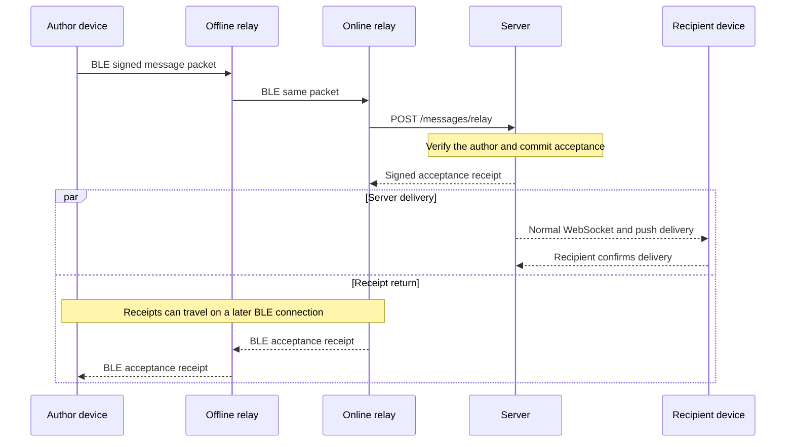

# BLE Mesh

BLE Mesh gives text messages, including replies, an offline route. A device can send an
encrypted message directly to a nearby recipient or pass it through other SecurityChat
devices until one can reach the server. A recipient that gets the message over BLE also
queues it for server delivery so the other recipient devices can receive it.

## BLE exchange

The app generates a random UUID for the local mesh queue and sends it in a hello frame after
connecting over BLE. The UUID lets the app recognize a previous relay after reconnecting. When a
packet
arrives, the device stores one copy in `mesh-messages.db` and records the UUID of each device
that sent it. The packet hash identifies duplicates across connections.

[ExchangeMeshMessagesWorker](mesh-data/src/commonMain/kotlin/com/security/chat/multiplatform/features/mesh/data/MeshMessageWorkers.kt)
runs through `BackgroundWorkManager`. Events such as a new outgoing message, a received BLE
packet, a ready peer, or a connectivity change can schedule an exchange. A periodic job requests
another exchange every 15 minutes; the OS can delay background work. The worker runs with or
without internet access and starts each peer's queue with receipts. It sends unsent outgoing
texts, outgoing texts with at least one recipient still in `Sent`, and relay packets
awaiting server acceptance. The periodic job retries eligible messages on an existing BLE
connection. The worker skips devices that supplied a relay packet.

When the user saves a new message during an exchange, the worker refreshes the outgoing queue
after the current BLE transfer. It alternates newly queued packets with remaining transfers
so both the new messages and the backlog make progress.

After accepting a packet, the receiving device sends a BLE acknowledgement with its hash.
It also acknowledges a previously seen copy so a lost acknowledgement can be recovered.
The sending device saves the hash and the peer's UUID and skips confirmed transfers on later
connections and periodic retries. Other peers can still receive the same packet. Devices
with older versions continue to exchange messages and use the existing retry behavior.

The author uses the original chat message ID in the packet, encrypts the text with AES-GCM,
and wraps the encryption key for each recipient using RSA-OAEP. An RSA-PSS signature covers
the encrypted content, wrapped keys, author, chat, recipients, and expiry. Relays transmit
the signed packet as received. A packet is valid for **seven days** from the time it is
created. The encoded mesh frame is limited to **16 KiB** and the BLE transport splits it
into smaller fragments. Preparing an outgoing packet requires the
recipients' public keys in the local cache. Attachments use the normal online route.

## Receiving and uploading

When the local user is a recipient, the app checks the chat membership and verifies the
signature with the cached public key of the author. It then decrypts the text, saves it in the
chat database, and uses the usual chat notification rules. If the chat or author key is
missing, the packet stays in mesh storage while the app waits for network access to fetch the
required data. The chat database uses the message ID to avoid inserting the same message
again when it arrives from the server.

`UploadMeshMessagesWorker` uploads received packets when internet access is available and
retries pending uploads through `BackgroundWorkManager`. Any authenticated relay can call
`POST /messages/relay`, including a device outside the chat. The server verifies the author's
signature, the author's device, and chat membership. The relay endpoint and the normal send
endpoint share the server's acceptance record, so valid retries do not start delivery again.

The device forwards a received message over BLE or uploads it for up to **24 hours** after
first receiving the packet, within its seven-day signed validity. The exchange worker
clears the encrypted payload at the next run, even when no BLE peers are ready. Mesh
storage keeps the packet hash until the signed expiry so a duplicate cannot restart the
retention period. For packets already stored before this change, the 24-hour period is
measured from the signed creation time because their receive time was never recorded.

## Acceptance and delivery

The server returns a signed receipt **after it commits acceptance in its database**.
Recipient delivery is confirmed separately. The client obtains the server's receipt
verification key from `GET /messages/relay/key` and caches it locally. The receipt identifies
the signed packet by its hash and includes the message ID and accepted recipients.

After checking the signature and matching it to the local packet, a relay stops forwarding
that packet and keeps the receipt for the devices that supplied it. The next BLE exchange
with any of those devices sends the receipt back. The author's device uses a valid receipt to
mark the message **Sent** and can continue sending its own packet over BLE until each recipient
confirms delivery. **Delivered** is driven by confirmation from the recipient.
Expired packets and receipts are cleaned up during queue processing. Signing out cancels
mesh work and clears the message queue, peer history, and local BLE UUID. The next signed-in
exchange advertises a new UUID, including over an already open BLE connection.

The orchestration is in
[MeshMessageService](mesh-data/src/commonMain/kotlin/com/security/chat/multiplatform/features/mesh/data/MeshMessageService.kt).
The SQLDelight schema is in
[mesh-data-storage](mesh-data-storage/src/commonMain/meshMessages).
